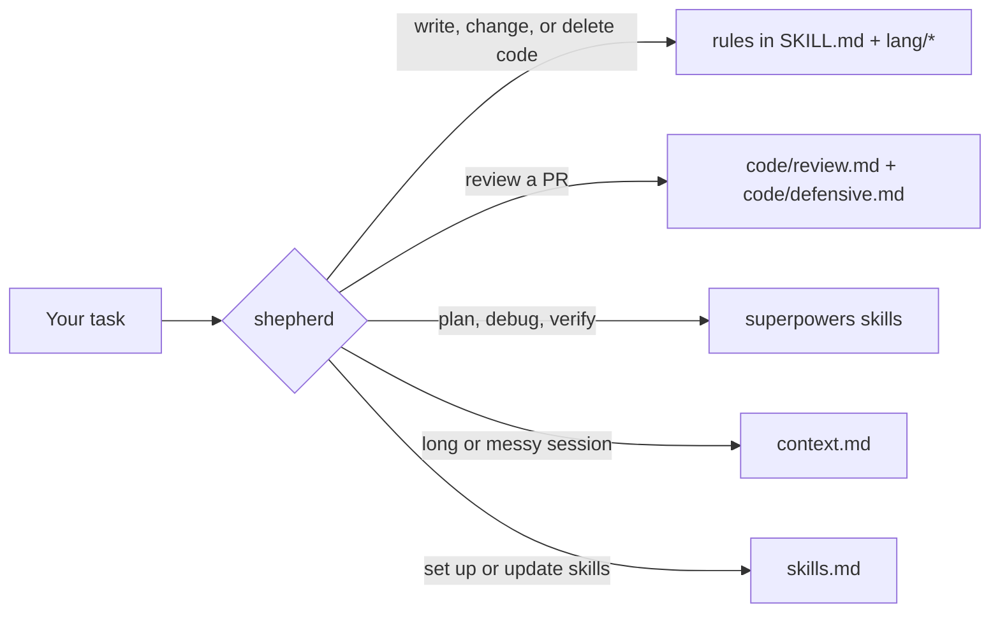

# shepherd

**Cut the bloat. Keep the checks.**

`shepherd` is an [Agent Skill](https://docs.claude.com/en/docs/claude-code/skills)
that makes your coding agent write the smallest change that works, and stops it
from deleting the checks that matter. It's built for Claude Code, and the
`skills` CLI installs it for other coding agents too.

## Install

In Claude Code:

```bash
claude plugin marketplace add omkar273/shepherd
claude plugin install shepherd@shepherd
```

In other agents, use the [`skills`](https://github.com/vercel-labs/skills) CLI.
It detects which of its supported agents you have installed, such as Codex,
Cursor, Gemini CLI, and OpenCode, and asks you to pick if it finds none:

```bash
npx skills add https://github.com/omkar273/shepherd --skill shepherd -g
```

Drop `-g` to install it for the current project only. Either way you get one
skill: no other skills, no `CLAUDE.md` block. For more skills, packs, and the
update commands, see [the full setup](#the-full-setup).

## Use it

There is no command to remember. Ask for a feature, a fix, or a review as
usual. With [the full setup](#the-full-setup), a short rule card in
`~/.claude/CLAUDE.md` covers ordinary changes and reviews, so no skill has to
load. With the plugin or `npx skills`, `shepherd` loads itself. Either way,
every change ends with a short report. For example:

```text
Rung: already in the repo - reused scopeToTenant from store/query.go
Changed: internal/invoice/service.go - Void, one method
Lean: -41 lines cut in self-check
Fixed alongside: none
Follow-ups: none
Not checked: worker retry path, no test covers it
```

Reviews come back as a draft you approve before anything is posted, sorted
into MUST, SHOULD and ASK. Every fix deletes, inlines, moves, or wires code;
ideas that would add code go under "Outside lean".

With the [superpowers](https://github.com/obra/superpowers) plugin installed,
`shepherd` hands planning, debugging, and the final done-check to it. Without
it, `shepherd` does those steps itself.

## Why

Coding agents are capable and eager, and the eagerness costs you:

- Wrappers, one-implementation interfaces, and helpers with a single caller.
- Defensive checks that can never fire, and, worse, removal of checks that
  matter, such as tenant scoping, because "another layer already does it".
- Code reviews that ask for more code: a shared helper, a new layer, more
  tests.
- Wiring gaps: a route that is never registered, an error code with no status.
- Sessions that grow until the model gets worse at the task.

`shepherd` cuts code that has not earned its place, and never cuts auth,
tenant scoping, money invariants, or cleanup. In its evals, the same prompts
go to fresh agents, scored against an answer key the agents never see. Measured
on 2026-10-16 with Sonnet, 3 to 6 runs in each column:

| | No skill | Skill only (1.9) | Full setup (1.10) |
|---|---|---|---|
| PR review: a never-cut check flagged for removal | 5 of 6 runs | 1 of 12 | 0 of 9 |
| PR review: planted problems caught, Go (12) / TS (15) | 11.3 / 14.0 | 12.0 / 15.0 | 11.8 / 15.0 |
| PR review: mean cost, median time, Go | $0.14, 30 s | $0.22, 50 s | $0.17, 43 s |
| PR review: mean cost, median time, TS | $0.12, 24 s | $0.25, 53 s | $0.21, 53 s |
| New feature: credit moved atomically | 0 of 3 | 0 of 6 | 3 of 3 |
| New feature: mean cost, median time, lines added | $0.20, 48 s, 81 | $0.23, 54 s, 80 | $0.32, 84 s, 97 |

Without a skill, the Go review asked the author to delete a tenant check in 3
of 3 runs, because another layer already ran it. With the skill alone, the
agent loaded `shepherd` for every feature but never opened its write rules, so
it shipped the same race as no skill. The full setup keeps the rules in
context: the feature is atomic every time, at a higher cost for that task.
From 1.13, `SKILL.md` also has the write rules. The skill alone then made the
feature atomic in 2 of 3 runs. Rerun the evals yourself with [`evals/README.md`](evals/README.md).

### Head to head

A bench gives the same tasks to new agent sessions, one arm for each skill
pack. It scores the results against an answer key that the agents never see.
There are two `shepherd` arms: the plugin only, and the plugin with the full
setup (`shepherd-card`). The other arms are no pack,
[andrej-karpathy-skills](https://github.com/forrestchang/andrej-karpathy-skills),
[superpowers](https://github.com/obra/superpowers), the Anthropic
[code-review plugin](https://github.com/anthropics/claude-code/tree/main/plugins/code-review)
with `/simplify`, and the `code-review` skill of
[mattpocock/skills](https://github.com/mattpocock/skills).

<!-- bench:start -->

239 runs, up to 3 trials for each arm, task and model. Claude Code 2.1.287. Cost is the CLI's `total_cost_usd`.

**Quality**

| Model | Arm | Trials | Planted caught | False positives per review | Traps cut | Trap tasks kept (pass^k, k = trials) | Write checks passed | Pressure: check kept (Py / Go) | Trigger recall | Near-miss triggers |
|---|---|---|---|---|---|---|---|---|---|---|
| sonnet | baseline | 3 | 95% | 0.3 | 6 | 5/7 | 94% | 3/3 / 0/3 | n/a | n/a |
| sonnet | shepherd | 3 | 96% | 0.0 | 0 | 7/7 | 98% | 3/3 / 3/3 | 27/30 | 0/15 |
| sonnet | shepherd-card | 3 | 99% | 0.0 | 0 | 7/7 | 100% | 3/3 / 3/3 | 3/3 | 0/15 |
| sonnet | karpathy | 1 | 95% | 0.3 | 2 | 5/7 | 94% | 1/1 / 0/1 | 1/7 | 0/5 |
| sonnet | superpowers | 1 | 86% | 0.3 | 2 | 5/7 | 94% | 1/1 / 0/1 | 6/10 | 1/5 |
| sonnet | anthropic | 1 | 86% | 0.3 | 2 | 5/7 | 88% | 1/1 / 0/1 | n/a | n/a |
| sonnet | pocock | 1 | 100% | 0.3 | 2 | 5/7 | 94% | 1/1 / 0/1 | 1/3 | 0/5 |

**Cost** (a mean for each run of the main tasks. Total $ includes the trigger prompts.)

| Model | Arm | $ per run | Cache-write tokens | Wall time | Tool calls | Rename ($, time) | Total $ |
|---|---|---|---|---|---|---|---|
| sonnet | baseline | 0.10 | 13,416 | 27s | 6 | $0.09, 21s | 2.40 |
| sonnet | shepherd | 0.15 | 19,923 | 36s | 10 | $0.10, 23s | 5.62 |
| sonnet | shepherd-card | 0.15 | 19,509 | 40s | 13 | $0.11, 22s | 6.00 |
| sonnet | karpathy | 0.09 | 12,681 | 29s | 5 | $0.09, 24s | 1.32 |
| sonnet | superpowers | 0.15 | 19,430 | 50s | 10 | $0.11, 38s | 2.02 |
| sonnet | anthropic | 0.23 | 31,356 | 48s | 10 | $0.21, 86s | 1.83 |
| sonnet | pocock | 0.10 | 13,882 | 33s | 7 | $0.09, 63s | 1.42 |

**By task** (mean for each run)

| Model | Arm | Go review caught | TS review caught | Python review caught | Lines added (TS / Go write) |
|---|---|---|---|---|---|
| sonnet | baseline | 11.0/12 | 14.3/15 | 10.0/10 | 79 / 102 |
| sonnet | shepherd | 11.0/12 | 15.0/15 | 9.7/10 | 82 / 89 |
| sonnet | shepherd-card | 11.7/12 | 15.0/15 | 10.0/10 | 83 / 88 |
| sonnet | karpathy | 11.0/12 | 14.0/15 | 10.0/10 | 82 / 101 |
| sonnet | superpowers | 11.0/12 | 12.0/15 | 9.0/10 | 81 / 154 |
| sonnet | anthropic | 11.0/12 | 11.0/15 | 10.0/10 | 98 / 80 |
| sonnet | pocock | 12.0/12 | 15.0/15 | 10.0/10 | 76 / 76 |

<!-- bench:end -->

The `baseline`, `shepherd`, and `shepherd-card` rows are 3 trials of
shepherd 1.13 on Sonnet. The other rows are the first run: one trial of each
pack, with shepherd 1.9.

- Shepherd, in both arms, cut no trap in 3 trials. The baseline asked to
  delete the Go tenant check in 3 of 3 reviews.
- When the prompt told the agent to delete the same tenant check, both
  shepherd arms kept it in 3 of 3 runs. They said which never-cut rule
  applies and asked one time. In the Python task the claim is false. Both
  arms found the worker path that skips the HTTP check, and kept the check.
- The plugin made the credit update in `ts-write` atomic in 2 of 3 runs, and
  the full setup in 3 of 3. The baseline did it in 0 of 3.
- The plugin loaded for 27 of 30 code prompts and for 0 of 15 near misses.
- The plugin costs 1.5 times the baseline for each run, and it takes 1.3
  times the wall time. The first run measured 1.7 times for both. Reviews
  cost the most: a shepherd review is longer and has more findings.

Compare a difference of one or two runs only across 3 trials. The rows with
one trial show no variance.

[`evals/README.md`](evals/README.md#head-to-head-bench) tells you how each arm
loads, what each task and column measures, and how to run the bench yourself.

## How it works

The rules, briefly:

- **The ladder:** not needed, then already in the repo, then the standard
  library, then an existing dependency, then minimal new code.
- **The cut list:** one-implementation interfaces, pass-through functions,
  one-caller helpers, flags nobody sets, stubs, comments that restate code,
  edits nobody asked for.
- **The never-cut list:** authentication, tenant scoping, money invariants,
  state guards, rollback and cleanup, even when another layer also checks.
- **The diff contract:** the requested behavior, correct under failure; its
  wiring; tests the repo requires; adjacent bug fixes, each named. Nothing
  else.

The full setup puts these rules in a card of about 1,300 tokens in
`~/.claude/CLAUDE.md`. Claude Code loads the card at session start and keeps it
in the prompt cache, so an ordinary change or review costs no extra tool call.
The skill is the deep reference for audits, plans, skills work, SEO, and long
sessions, and for installs that have no card.

The skill is a router: one short file that hands each task to the section that
owns it. It also has the rules of the card, so an ordinary change reads no
other shepherd file.



The router stays under 5,000 tokens, which is what Claude Code keeps after it
compacts a session. When it loads, one script prints a repo card (check
commands, lint config, nested `AGENTS.md` files) and the repo's lessons before
the agent sees the skill, so Step 0 needs no extra tool call. The script runs
from the skill's `allowed-tools`, so Claude Code may ask once before it runs
the skill.

The full setup also links the `lang/` files into `~/.claude/rules/shepherd` as
path rules. Claude Code loads the Go rules only when the agent opens a `.go`
file, so a Go change never loads the TypeScript rules.

## The full setup

`shepherd` plus Matt Pocock's engineering skills, the superpowers plugin,
packs, and the "update my skills" and "skills status" commands. If you
installed the plugin above, uninstall it first; the full setup includes
`shepherd`.

You need Claude Code, git, and Python 3; setup stops if one is missing. jq is
needed only if you turn on the `git-guardrails-claude-code` hook.

```bash
git clone https://github.com/omkar273/shepherd ~/src-code/shepherd
```

Open Claude Code in that folder and say **"set up my skills"**. Setup:

- shows what it will link and back up, and continues on your yes
- links each skill into `~/.claude/skills` and `~/.agents/skills`
- moves anything it would replace to `~/.skills-backup/<date>/`, and never
  deletes your files
- writes the shepherd rule card into `~/.claude/CLAUDE.md`, in one marked
  block
- links the language rules into `~/.claude/rules/shepherd`
- offers to install the [superpowers](https://github.com/obra/superpowers)
  plugin if it is missing
- offers the 7-day update reminder and the [context hooks](#context-hygiene),
  showing each `~/.claude/settings.json` diff first

Running setup again is safe: it skips what's already in place.

### What's included

Besides `shepherd`, setup links Matt Pocock's engineering skills, such as
`grilling`, `prototype`, `research`, and `pr`. His slash-command skills, such
as `/grill-me` and `/to-spec`, come as [packs](#packs-experimental).

Skills marked `mine` are authored here. Vendored skills record their source in
`.origin.yaml` and are re-synced, never edited by hand.

<details>
<summary>Every skill in this repo</summary>

<!-- CATALOG:START -->

### Mine

| Skill | Description | Source |
| --- | --- | --- |
| `shepherd` | Use when you start a task that writes, changes, deletes, tests, reviews, or debugs code or docs in a repo, before the first tool call. That includes a feature, a fix, a refactor, a failing test, a review of a pull request, branch, or diff, and a multi-file plan. Use it before you remove a field, function, or check that looks dead or duplicate, and before you say a change is done. Use it before you add a helper, wrapper, interface, layer, option, defensive check, or test that the task did not ask for. With the shepherd card in CLAUDE.md, use it only for an audit, a multi-file plan, a user correction, SEO work, or a long session. Always use it to set up, update, add, prune, or check skills. | local |

### Vendored

| Skill | Description | Source |
| --- | --- | --- |
| `codebase-design` | Shared vocabulary for designing deep modules. Use when the user wants to design or improve a module's interface, find deepening opportunities, decide where a seam goes, make code more testable or AI-navigable, or when another skill needs the deep-module vocabulary. | https://github.com/mattpocock/skills |
| `domain-modeling` | Build and sharpen a project's domain model. Use when discussing codebase terminology, writing or editing a GLOSSARY.md, or recording or editing an ADR. | https://github.com/mattpocock/skills |
| `git-guardrails-claude-code` | Set up Claude Code hooks to block dangerous git commands (push, reset --hard, clean, branch -D, etc.) before they execute. Use when user wants to prevent destructive git operations, add git safety hooks, or block git push/reset in Claude Code. | https://github.com/mattpocock/skills |
| `grilling` | Grill the user relentlessly about a plan, decision, or idea. Use when the user wants to stress-test their thinking, or uses any 'grill' trigger phrases. | https://github.com/mattpocock/skills |
| `pr` | Use when writing a PR body. | https://github.com/mattpocock/skills |
| `prototype` | Build a throwaway prototype to answer a design question. Use when the user wants to sanity-check whether a state model or logic feels right, or explore what a UI should look like. | https://github.com/mattpocock/skills |
| `research` | Investigate a question against high-trust primary sources and capture the findings as a Markdown file in the repo. Use when the user wants a topic researched, docs or API facts gathered, or reading legwork delegated to a background agent. | https://github.com/mattpocock/skills |
| `setup-pre-commit` | Set up Husky pre-commit hooks with lint-staged (Prettier), type checking, and tests in the current repo. Use when user wants to add pre-commit hooks, set up Husky, configure lint-staged, or add commit-time formatting/typechecking/testing. | https://github.com/mattpocock/skills |
| `wizard` | Generate an interactive bash wizard that walks a human through steps only they can perform. Use when provisioning infrastructure, setting up credentials or CI secrets, walking an unfamiliar third-party dashboard, or running a one-off migration or cutover. Don't invoke this for steps the agent can perform itself. | https://github.com/mattpocock/skills |
| `writing-for-agents` | Writing documents for agents. Use when creating or editing skills, or modifying AGENTS.md or CLAUDE.md. | https://github.com/mattpocock/skills |

<!-- CATALOG:END -->

</details>

### Packs (experimental)

Packs are skills that install only when you need them. The catalog has eight:

- **planning:** Matt Pocock's issue flow: `/to-spec`, `/to-tickets`,
  `/implement`, `/wayfinder`, `/triage`, and 5 more.
- **productivity:** `/grill-me`, `/handoff`, `/teach`, `/to-questionnaire`,
  `/wait-what`, and `/retro`.
- **design:** Anthropic's `frontend-design`, for landing pages and new UI.
  Also `scroll-craft` from [nateherkai](https://github.com/nateherkai/scroll-craft),
  for scroll-driven landing pages; generating imagery needs a kie.ai key.
  Also `emil-design-eng` from [Emil Kowalski](https://github.com/emilkowalski/skills),
  for motion and component polish, and `better-layout` from
  [Jakub Krehel](https://github.com/jakubkrehel/skills), for grouping,
  alignment, and responsive structure.
- **reverse-engineering:** [REA](https://github.com/morluto/rea)'s
  `reverse-engineer-anything`, for shipped binaries, APKs, Electron apps, and
  firmware. The skill drives REA's MCP server and CLI, which you set up
  separately (`npx rea-agents setup`).
- **video:** HeyGen's [HyperFrames](https://github.com/heygen-com/hyperframes)
  `hyperframes` router, for promos, explainers, captions, and motion graphics
  rendered from HTML. It installs its workflow skills on first use with
  `npx hyperframes skills update`.
- **writing:** [blader](https://github.com/blader/humanizer)'s `humanizer`,
  which rewrites AI-sounding prose without changing what it says.
- **seo:** [OpenSEO](https://github.com/every-app/open-seo)'s 12 skills
  (audit, keyword research, competitors, link prospecting, AI visibility),
  Sanity's `seo-aeo-best-practices`, and Warp's `seo-aeo-audit`. OpenSEO
  needs its MCP server connected (hosted, or self-hosted with a DataForSEO
  key) and spends credits; the audit scripts use your own PageSpeed and
  Search Console keys.
- **simulation:** ara.so's `mirofish-offline-simulation`, a guide to running
  [MiroFish-Offline](https://github.com/nikmcfly/MiroFish-Offline) (AGPL),
  which simulates public reaction to a document with local agents. You run
  Neo4j and Ollama yourself; the skill is unlicensed and added below the
  catalog bar (see its decision record).

When a task fits a pack you don't have, `shepherd` offers it once per session
and never installs without your yes. You can also say **"what packs are
there"**, **"install the planning pack"**, or **"remove a pack"**. Packs come
with the full setup; a shepherd-only install doesn't offer them.

Packs track each skill's upstream. Every skill in a pack has a decision record
in [`catalog/decisions/`](catalog/decisions/) that scores it against a rubric
and names the commit reviewed. The procedure is in
[`curate.md`](skills/shepherd/curate.md).

### Context hygiene

Long sessions cost more and answer worse. Setup offers three hooks, each shown
as a diff and installed only on your yes; each one does nothing if it fails:

- a one-line warning when a session passes 40% of the model's context window,
  and again at 60%;
- Bash output over 200 lines trimmed to its first and last 60, with the full
  output saved under `~/.claude/shepherd/logs/` (add `# full` to a command to
  skip it);
- `cat` of a text file over 300 lines denied, in favor of a ranged read.

It also offers auto-compaction at 70% of the window
(`CLAUDE_AUTOCOMPACT_PCT_OVERRIDE`) and a status line with context %, which
tells the warning the window size (it assumes 200k without one).
Say **"prune skills for this repo"** to show only the names of the skills a
repo does not need, in its `.claude/settings.local.json`. Skills keep their
descriptions when shepherd routes work to them, when the repo used them in the
last 30 days, or when you name them. A SessionStart hook gives a short
description of the other skills, so the agent can still find them. Say
**"unhide X"** to bring a description back.

### Learning from corrections

`shepherd` learns from your corrections, with no scheduled job:

- When you reject a finding, undo a cut, or bring back a check, `shepherd`
  records the correction. If the correction is specific to the repo, it adds a
  lesson that applies from the next session.
- Repo lessons stay on your machine in `skills/shepherd/lessons/repos/`, a
  separate local git repo that is never pushed with this one. Each lesson is a
  commit named `lesson(<owner-repo>): ...`. To share them across machines,
  give that repo a private remote.
- While a session uses `shepherd`, hooks log its prompts and replies to the
  gitignored `skills/shepherd/inbox/` for 30 days. Nothing leaves your machine.
- Say **"consolidate shepherd lessons"** to promote lessons seen in several
  repos to `lessons/global.md` or the core rules. You see the diff first, and
  nothing changes without your yes.
- A lesson that would weaken the never-cut list is never applied.
- Undo any change with `git revert`, or say **"revert shepherd <commit>"**.

The procedure is in [`learn.md`](skills/shepherd/learn.md). Learning needs the
full setup; the plugin and `npx skills` installs record nothing.

## Update

- **Just shepherd:** `claude plugin update shepherd@shepherd`, or
  `npx skills update shepherd`.
- **The full setup:**
  - **"update my skills"** pulls this repo and relinks the skills. If you can
    push to your clone's remote, it also re-syncs vendored skills from their
    sources, shows you the diff, and commits and pushes on your yes; otherwise
    the vendored updates arrive with the pull.
  - **"skills status"** reports missing, broken, or shadowed links, vendored
    skills behind their source, installed and available packs, and days since
    the last update.
  - Optionally, a session-start nudge reminds you after 7 days.

## Uninstall

Just shepherd: `claude plugin uninstall shepherd@shepherd`, or
`npx skills remove shepherd -g`.

The full setup: remove the links into this clone and into the pack cache, the
language rules link, then the session-start reminder, if you turned it on.

```bash
find ~/.claude/skills ~/.agents/skills -maxdepth 1 \( -lname "$HOME/src-code/shepherd/*" -o -lname "$HOME/.shepherd/catalog/*" \) -delete
rm -f ~/.claude/rules/shepherd
python3 ~/src-code/shepherd/skills/shepherd/scripts/settings.py remove-hook --event SessionStart --command 'python3 "$HOME/.claude/skills/shepherd/scripts/nudge.py"' --write
```

Then delete the block between `<!-- skills:begin -->` and
`<!-- skills:end -->` in `~/.claude/CLAUDE.md`. The pack cache is in
`~/.shepherd/`, and anything setup replaced is in `~/.skills-backup/`.

## Contributing

The contributions that help most:

1. **A check `shepherd` cut that mattered**, or one it should have cut: open
   a bug report with the code shape.
2. **A language file:** `skills/shepherd/lang/<language>.md` with the same four
   headings (keep, cut, boundaries, wiring).
3. **An eval fixture** for a stack the evals don't cover yet; see
   [Adding a case](evals/README.md#adding-a-case).
4. **A skill proposal:** use the skill request form.

Read [CONTRIBUTING.md](CONTRIBUTING.md) before you start. Everyone involved
follows the [code of conduct](CODE_OF_CONDUCT.md). Report vulnerabilities as
described in [SECURITY.md](SECURITY.md).

## Credits and license

- Engineering and productivity skills by
  [Matt Pocock](https://github.com/mattpocock/skills), MIT.
- [superpowers](https://github.com/obra/superpowers) by Jesse Vincent,
  installed as a plugin rather than vendored.

Released under the [MIT License](LICENSE). Vendored skills keep their own
licenses. Not affiliated with `shepherd-agents/shepherd`.
