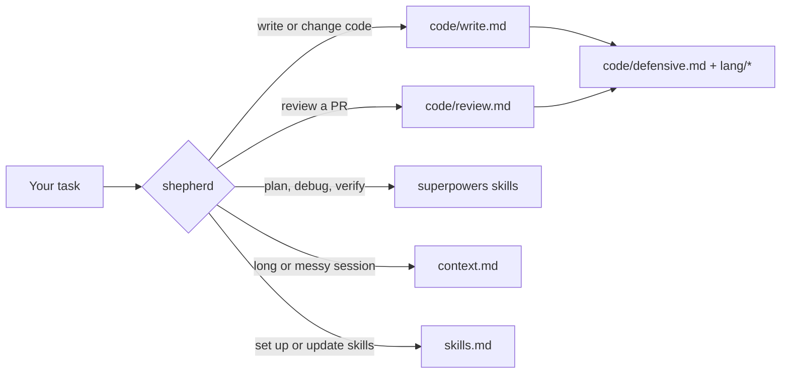

# shepherd

**Cut the bloat. Keep the checks.**

`shepherd` is an [Agent Skill](https://docs.claude.com/en/docs/claude-code/skills)
that makes your coding agent write the smallest change that works, and stops it
from deleting the checks that matter. It runs in Claude Code and in any agent
that reads `~/.agents/skills`.

## Sound familiar?

Coding agents are capable and eager, and the eagerness costs you:

- Wrappers, one-implementation interfaces, and helpers with a single caller.
- Defensive checks that can never fire, and, worse, removal of checks that
  matter, such as tenant scoping, because "another layer already does it".
- Code reviews that ask for more code: a shared helper, a new layer, more
  tests.
- Wiring gaps: a route that is never registered, an error code with no status.
- Sessions that grow until the model gets worse at the task.

## The receipts

Same prompts, fresh agents, scored against an answer key the agents never see.
Rerun them yourself with [`evals/README.md`](evals/README.md).

| | Without shepherd | With shepherd |
|---|---|---|
| Same feature, lines added (Go / TypeScript)\* | 310 / 132 | 125 / 59 |
| PR review: planted problems caught | 25 of 27 | 27 of 27 |
| PR review: tenant-scoping check flagged for removal | yes | no |

Without the skill, the agent's review asked the author to delete a tenant check
because another layer already ran it. That is the mistake `shepherd` exists to
stop: it cuts code that has not earned its place, and never cuts auth, tenant
scoping, money invariants, or cleanup.

\* Measured on 2026-10-11 with the same rules under their earlier name, `lean`.

## What you see

There is no command to remember. Ask for a feature, a fix, or a review as
usual; `shepherd` loads itself, and every change ends with a short report. For
example:

```text
Rung: already in the repo - reused scopeToTenant from store/query.go
Changed: internal/invoice/service.go - Void, one method
Lean: -41 lines cut in self-check
Fixed alongside: none
Follow-ups: none
Not checked: worker retry path, no test covers it
```

Reviews come back as a draft you approve before anything is posted, sorted
into MUST, SHOULD and ASK. Every fix deletes, inlines, moves, or wires code;
ideas that would add code go under "Outside lean".

## Quick start

### Just shepherd

One skill: no other skills, no `CLAUDE.md` block, no superpowers. In Claude
Code:

```bash
claude plugin marketplace add omkar273/shepherd
claude plugin install shepherd@shepherd
```

In Codex, Cursor, Gemini CLI, opencode and other agents, use the
[`skills`](https://github.com/vercel-labs/skills) CLI:

```bash
npx skills add https://github.com/omkar273/shepherd --skill shepherd -g
```

Drop `-g` to install it for the current project only. Without the
[superpowers](https://github.com/obra/superpowers) plugin, `shepherd` does the
planning, debugging, and verification steps itself instead of handing them
off.

### The full setup

`shepherd`, the skills it routes to, superpowers, and the "update my skills"
and "skills status" commands. If you installed the plugin above, uninstall it
first; the full setup includes `shepherd`.

```bash
git clone https://github.com/omkar273/shepherd ~/src-code/shepherd
```

Open Claude Code in that folder and say **"set up my skills"**. Setup:

- links each skill into `~/.claude/skills` and `~/.agents/skills`
- moves anything it would replace to `~/.skills-backup/<date>/`, and never
  deletes
- writes one marked block into `~/.claude/CLAUDE.md`
- shows a diff and asks before it touches `~/.claude/settings.json`
- installs the [superpowers](https://github.com/obra/superpowers) plugin if it
  is missing

Running setup again is safe: a second run changes nothing.

## How it works



The router stays under 5,000 tokens, which is what Claude Code keeps after it
compacts a session. Everything else loads only when the task needs it, and a
Go change never loads the TypeScript rules.

The rules, briefly:

- **The ladder:** not needed, then already in the repo, then the standard
  library, then an existing dependency, then minimal new code.
- **The cut list:** one-implementation interfaces, pass-through functions,
  one-caller helpers, flags nobody sets, stubs, comments that restate code,
  edits nobody asked for.
- **The never-cut list:** authentication, tenant scoping, money invariants,
  state guards, rollback and cleanup, even when another layer also checks.
- **The diff contract:** the requested behavior, correct under failure; its
  wiring; tests the repo requires; adjacent bug fixes, each named. Nothing
  else.

## What setup also gives you

`shepherd` hands planning, debugging, and the final done-check to the
[superpowers](https://github.com/obra/superpowers) skills, and setup links the
other skills it routes to: Matt Pocock's engineering skills, `frontend-design`,
`ui-ux-pro-max`, and `graphify`. Several are slash commands you run yourself,
such as `/grill-me` and `/to-spec`.

Skills marked `mine` are authored here. Vendored skills record their source in
`.origin.yaml` and are re-synced, never edited by hand.

<details>
<summary>Every skill in this repo</summary>

<!-- CATALOG:START -->

### Mine

| Skill | Description | Source |
| --- | --- | --- |
| `shepherd` | Use when writing, changing, or reviewing code in any repo - implementing a feature or fix, refactoring, reviewing a teammate's pull request, a branch, or a diff (before or alongside code-review), debugging, planning a multi-file change, or wrapping up a change before saying it is done - whenever about to add a helper, wrapper, interface, layer, option, defensive check, or test the task did not ask for, and when setting up, updating, adding, or checking skills. | local |

### Vendored

| Skill | Description | Source |
| --- | --- | --- |
| `ask-matt` | Ask which skill or flow fits your situation. A router over the skills in this repo. | https://github.com/mattpocock/skills |
| `codebase-design` | Shared vocabulary for designing deep modules. Use when the user wants to design or improve a module's interface, find deepening opportunities, decide where a seam goes, make code more testable or AI-navigable, or when another skill needs the deep-module vocabulary. | https://github.com/mattpocock/skills |
| `domain-modeling` | Build and sharpen a project's domain model. Use when discussing codebase terminology, writing or editing a GLOSSARY.md, or recording or editing an ADR. | https://github.com/mattpocock/skills |
| `frontend-design` | Guidance for distinctive, intentional visual design when building new UI or reshaping an existing one. Helps with aesthetic direction, typography, and making choices that don't read as templated defaults. | https://github.com/anthropics/skills |
| `git-guardrails-claude-code` | Set up Claude Code hooks to block dangerous git commands (push, reset --hard, clean, branch -D, etc.) before they execute. Use when user wants to prevent destructive git operations, add git safety hooks, or block git push/reset in Claude Code. | https://github.com/mattpocock/skills |
| `graphify` | any input (code, docs, papers, images, videos) to knowledge graph. Use when user asks any question about a codebase, documents, or project content - especially if graphify-out/ exists, treat the question as a /graphify query. | local |
| `grill-me` | A relentless interview to sharpen a plan or design. | https://github.com/mattpocock/skills |
| `grill-with-docs` | A relentless interview to sharpen a plan or design, which also creates docs (ADR's and glossary) as we go. | https://github.com/mattpocock/skills |
| `grilling` | Grill the user relentlessly about a plan, decision, or idea. Use when the user wants to stress-test their thinking, or uses any 'grill' trigger phrases. | https://github.com/mattpocock/skills |
| `handoff` | Compact the current conversation into a handoff document for another agent to pick up. | https://github.com/mattpocock/skills |
| `implement` | Implement a piece of work based on a spec or set of tickets. | https://github.com/mattpocock/skills |
| `implement-spec` | Implement the result of /to-spec and /to-tickets in code. | https://github.com/mattpocock/skills |
| `improve-codebase-architecture` | Scan a codebase for deepening opportunities, present them as a visual HTML report, then grill through whichever one you pick. | https://github.com/mattpocock/skills |
| `pr` | Use when writing a PR body. | https://github.com/mattpocock/skills |
| `prototype` | Build a throwaway prototype to answer a design question. Use when the user wants to sanity-check whether a state model or logic feels right, or explore what a UI should look like. | https://github.com/mattpocock/skills |
| `research` | Investigate a question against high-trust primary sources and capture the findings as a Markdown file in the repo. Use when the user wants a topic researched, docs or API facts gathered, or reading legwork delegated to a background agent. | https://github.com/mattpocock/skills |
| `retro` | Conduct a retrospective on a coding session. | https://github.com/mattpocock/skills |
| `setup-matt-pocock-skills` | Configure this repo for the engineering skills: set up its issue tracker, triage label vocabulary, and domain doc layout. Run once before first use of the other engineering skills. | https://github.com/mattpocock/skills |
| `setup-pre-commit` | Set up Husky pre-commit hooks with lint-staged (Prettier), type checking, and tests in the current repo. Use when user wants to add pre-commit hooks, set up Husky, configure lint-staged, or add commit-time formatting/typechecking/testing. | https://github.com/mattpocock/skills |
| `teach` | Teach the user a new skill or concept, within this workspace. | https://github.com/mattpocock/skills |
| `to-questionnaire` | Turn a decision you can't fully answer into a questionnaire for someone else to fill in. | https://github.com/mattpocock/skills |
| `to-spec` | Turn the current conversation into a spec and publish it to the project issue tracker: no interview, just synthesis of what you've already discussed. | https://github.com/mattpocock/skills |
| `to-tickets` | Break a plan, spec, or the current conversation into a set of tracer-bullet tickets, each declaring its blocking edges, published to the configured tracker (edges as text in one file per ticket locally, or native blocking links on a real tracker). | https://github.com/mattpocock/skills |
| `triage` | Move issues and external PRs through a state machine of triage roles, categorise, verify, grill if needed, and write agent-ready briefs. | https://github.com/mattpocock/skills |
| `ui-ux-pro-max` | UI/UX design intelligence. 67 styles, 161 palettes, 57 font pairings, 25 charts, 21 stacks (React, Next.js, Vue, Svelte, Astro, SwiftUI, React Native, Flutter, WPF, WinUI 3, UWP, Avalonia, Uno Platform, Nuxt, Nuxt UI, Tailwind, shadcn/ui, Jetpack Compose, Three.js, Angular, Laravel). Actions: plan, build, create, design, implement, review, fix, improve, optimize, enhance, refactor, check UI/UX code. Projects: website, landing page, dashboard, admin panel, e-commerce, SaaS, portfolio, blog, mobile app, desktop app, .html, .tsx, .vue, .svelte, .xaml. Elements: button, modal, navbar, sidebar, card, table, form, chart. Styles: glassmorphism, claymorphism, minimalism, brutalism, neumorphism, bento grid, dark mode, responsive, skeuomorphism, flat design. Topics: color palette, accessibility, animation, layout, typography, font pairing, spacing, hover, shadow, gradient. Integrations: shadcn/ui MCP for component search and examples. | https://github.com/nextlevelbuilder/ui-ux-pro-max-skill |
| `wait-what` | Stop. That last message did not land: re-pitch it. | https://github.com/mattpocock/skills |
| `wayfinder` | Plan a huge chunk of work (more than one agent session can hold) as a shared map of decision tickets on your issue tracker, and resolve them one at a time until the way to the destination is clear. | https://github.com/mattpocock/skills |
| `wizard` | Generate an interactive bash wizard that walks a human through steps only they can perform. Use when provisioning infrastructure, setting up credentials or CI secrets, walking an unfamiliar third-party dashboard, or running a one-off migration or cutover. Don't invoke this for steps the agent can perform itself. | https://github.com/mattpocock/skills |
| `writing-for-agents` | Writing documents for agents. Use when creating or editing skills, or modifying AGENTS.md or CLAUDE.md. | https://github.com/mattpocock/skills |

<!-- CATALOG:END -->

</details>

## Keeping it current

- **"update my skills"** pulls this repo, re-syncs vendored skills from their
  sources, shows you the diff, and commits on your yes.
- **"skills status"** reports missing, broken, or shadowed links, vendored
  skills behind their source, and days since the last update.
- Optionally, a session-start nudge reminds you after 7 days.
- **Just shepherd:** `claude plugin update shepherd@shepherd`, or
  `npx skills update shepherd`.

## Roadmap

These are in design. Nothing below has shipped yet.

- **Context hygiene hooks:** warn when a session passes 200k tokens, trim long
  command output to its head and tail with the full log saved, and redirect
  whole-file dumps to ranged reads.
- **Learning from corrections:** when you reject a finding or undo a cut,
  `shepherd` records a lesson for that repo. Promoting lessons into the core
  rules happens only on request, with an eval run.
- **Skill catalog:** domain packs (content, design, and more) that are
  fetched on demand from pinned sources and offered when a task needs them.
  Every addition or removal is justified by a rubric and a trial run, and the
  decision is committed as a record.

## Add value

The contributions that help most each end as a new eval case:

1. **A check `shepherd` cut that mattered**, or one it should have cut: open
   a bug report with the code shape. It becomes a fixture, then a rule.
2. **A language file:** `skills/shepherd/lang/<language>.md` with the same four
   headings (keep, cut, boundaries, wiring).
3. **An eval fixture** for a stack the evals don't cover yet.
4. **A skill proposal:** use the skill request form.

Read [CONTRIBUTING.md](CONTRIBUTING.md) before you start. Everyone involved
follows the [code of conduct](CODE_OF_CONDUCT.md). Report vulnerabilities as
described in [SECURITY.md](SECURITY.md).

## Uninstall

Just shepherd: `claude plugin uninstall shepherd@shepherd`, or
`npx skills remove shepherd -g`.

The full setup:

```bash
find ~/.claude/skills ~/.agents/skills -maxdepth 1 -lname "$HOME/src-code/shepherd/*" -delete
```

That removes only the links into this clone. Then delete the block between
`<!-- skills:begin -->` and `<!-- skills:end -->` in `~/.claude/CLAUDE.md`.
Anything setup replaced is in `~/.skills-backup/`.

## Credits and license

- Engineering and productivity skills by
  [Matt Pocock](https://github.com/mattpocock/skills), MIT.
- [superpowers](https://github.com/obra/superpowers) by Jesse Vincent,
  installed as a plugin rather than vendored.
- `frontend-design`, `ui-ux-pro-max` and `graphify` come from their upstream
  projects; see [NOTICE](NOTICE).

Released under the [MIT License](LICENSE). Vendored skills keep their own
licenses. Not affiliated with `shepherd-agents/shepherd`.
